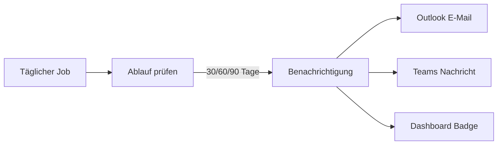

# Unified Carbonauten Platform — Sprint Roadmap

**Slogan:** FuckCo2 goes international

Produktions-Roadmap für die interne Multichannel-Plattform: Artikel, Dateien und **Zertifikate** zentral verwalten und an Microsoft 365 (Outlook, Teams) sowie Notion verteilen — nutzbar für technische und nicht-technische Mitarbeiter in Europa und China.

---

## Vision

Eine selbsterklärende Web-Plattform, auf der Teams Inhalte und Zertifikate einmal erfassen und gezielt an mehrere Kanäle veröffentlichen — mit Microsoft-Login, dreisprachiger Oberfläche (DE / EN / 中文) und kostengünstigem Betrieb über GitHub + Azure/Alibaba.

```mermaid
flowchart LR
    subgraph Sprint1["✅ Sprint 1"]
        Auth[Entra ID Login]
        I18n[DE / EN / 中文]
        Nav[Navigation]
    end

    subgraph Sprint2["Sprint 2"]
        Editor[Artikel-Editor]
        Files[Datei-Upload]
    end

    subgraph Sprint3["Sprint 3"]
        Certs[Zertifikatsverwaltung]
        Reminders[Ablauf-Erinnerungen]
    end

    subgraph Sprint4["Sprint 4"]
        Teams[Teams]
        Notion[Notion]
        Outlook[Outlook]
    end

    subgraph Sprint5["Sprint 5"]
        China[China Deployment]
        Sync[EU ↔ China Sync]
    end

    subgraph Sprint6["Sprint 6"]
        Workflow[Freigabe-Workflow]
        Audit[Audit & Monitoring]
    end

    Sprint1 --> Sprint2 --> Sprint3 --> Sprint4 --> Sprint5 --> Sprint6
```



---

## Sprint-Übersicht

| Sprint | Dauer | Status | Ziel |
|--------|-------|--------|------|
| 1 | 2 Wochen | ✅ Abgeschlossen | Fundament: Login, Branding, Mehrsprachigkeit, CI/CD |
| 2 | 2 Wochen | ✅ Abgeschlossen | Redaktion: Artikel-Editor, Dateiverwaltung, Suche |
| 3 | 2 Wochen | ✅ Abgeschlossen | **Zertifikatsverwaltung:** Erfassung, Ablauf, Erinnerungen |
| 4 | 2 Wochen | ✅ Abgeschlossen | Multichannel: Teams, Notion, Outlook |
| 5 | 2 Wochen | ✅ Abgeschlossen (MVP) | China: Alibaba-Deployment, Datensync EU ↔ CN |
| 6 | 1 Woche | ✅ Abgeschlossen (MVP) | Workflow, Freigaben, Audit, Go-Live |
| 7 | 1 Woche | ✅ Abgeschlossen (MVP) | Versionierung: Artikel- & Zertifikat-Historie |
| UI | 2–3 Tage | ✅ Abgeschlossen | Responsive Navigation, Status-Badges, Polish |
| UI 2 | 2–3 Tage | ✅ Abgeschlossen | Loading/Empty States, Badges, Audit-Mobile |
| Search + AI | 3–5 Tage | ✅ Abgeschlossen (MVP) | Zentrale Suche, KI-Fragen, ⌘K |
| A | 3–5 Tage | ✅ Abgeschlossen | Ask Carbonauten live: Translate, Summarize, richer RAG |
| B | 3–5 Tage | ✅ Abgeschlossen | Zertifikat-Ketten, Erinnerungen, Audit-Export |
| C | 3–5 Tage | ✅ Abgeschlossen | Mein Dashboard + Veröffentlichungskalender |
| D | 2–4 Tage | ✅ Abgeschlossen | Version Restore für Artikel & Zertifikate |
| E | 2–4 Tage | ✅ Abgeschlossen | Analytics Dashboard (Publish & Zertifikate) |
| F | 2–4 Tage | ✅ Abgeschlossen | SharePoint-Zertifikat-Import |
| G | 3–5 Tage | ✅ Abgeschlossen (Produktiv) | FuckCo2 Shop + Checkout + Bestellungen |
| H | 2–4 Tage | ✅ Abgeschlossen (MVP) | Auto-Import CA (PEM / LE / Key Vault) |
| I | 2–4 Tage | ✅ Abgeschlossen (MVP) | Shop-Retouren / Gutschriften |
| J | 2–4 Tage | ✅ Abgeschlossen (MVP) | Mobile PWA + Zertifikat-Ketten UI |
| K | 2–4 Tage | ✅ Abgeschlossen (MVP) | Shop-Versandverfolgung + Status-Mails |
| L | 2–4 Tage | ✅ Abgeschlossen (MVP) | Shop-Rechnungs-PDF |
| M | 2–4 Tage | ✅ Abgeschlossen (MVP) | Web-Reputation-Crawler + Löschanträge |
| N | 2–4 Tage | ✅ Abgeschlossen (MVP) | M365-Verwaltung + Ask Carbonauten |
| O | 2–4 Tage | ✅ Abgeschlossen (MVP) | Entra-Gruppen-Mapping + Lizenz-Zuweisung |
| P | 2–4 Tage | ✅ Abgeschlossen (MVP) | Semantische Suche (Embeddings) |
| Q | 2–4 Tage | ✅ Abgeschlossen (MVP) | KI-Schreibassistenz im Artikel-Editor |
| R | 2–4 Tage | ✅ Abgeschlossen (MVP) | M365 Ask: LLM-Function-Calling |
| S | 1–2 Tage | ✅ Abgeschlossen (MVP) | Volltext-Diff für Versionshistorie |
| 8+ | laufend | Backlog | Erweiterungen (siehe unten) |

---

## Sprint 1 — Fundament ✅

**Ziel:** Mitarbeiter können sich anmelden und die Plattform in ihrer Sprache nutzen.

### Deliverables

- [x] Projektstruktur `services/content-hub/`
- [x] FastAPI-Backend mit Entra-ID-Login (Mock-Modus für Dev)
- [x] React-Frontend mit Language Switch: `de`, `en`, `zh-CN`
- [x] Branding: Logo, **Unified Carbonauten Platform**, Slogan
- [x] Dashboard, Artikel, Dateien, **Zertifikate**, Veröffentlichen (Navigation)
- [x] GitHub Actions → GHCR
- [x] Helm Chart + Argo CD Manifest
- [x] Terraform-Scaffold Azure Container Apps
- [x] Tests (Backend)

### Akzeptanzkriterien

- Login mit Microsoft (oder Mock in Dev)
- UI vollständig in drei Sprachen umschaltbar
- CI baut und testet bei jedem Push
- Docker-Image lauffähig

---

## Sprint 2 — Redaktion & Dateien ✅

**Ziel:** Mitarbeiter können Artikel schreiben und Dateien hochladen — ohne technisches Know-how.

### Deliverables

- [x] WYSIWYG-Artikel-Editor (TipTap)
- [x] Artikel-CRUD: Erstellen, Bearbeiten, Löschen, Entwurf / Veröffentlicht
- [x] Vorlagen: Wochenbericht, Ankündigung, Protokoll
- [x] Datei-Upload per Drag & Drop
- [x] Ordnerstruktur (general, compliance, marketing)
- [x] Volltextsuche über Artikel und Dateinamen
- [x] SQLite/PostgreSQL via SQLAlchemy (`DATABASE_URL`)
- [x] Lokaler Dateispeicher (`UPLOAD_DIR`)
- [x] API-Tests

### Akzeptanzkriterien

- Redakteur erstellt Artikel mit Formatierung (fett, Listen, Links)
- Dateien werden hochgeladen und sind wieder auffindbar
- Suche liefert relevante Treffer in < 2 Sekunden
- Alle UI-Texte in DE / EN / 中文

### Technik

```
backend/app/models/article.py
backend/app/models/file.py
backend/app/routes/articles.py
backend/app/routes/files.py
frontend/src/pages/ArticleEditor.tsx
frontend/src/pages/FilesPage.tsx (erweitert)
```

---

## Sprint 3 — Zertifikatsverwaltung

**Ziel:** Alle relevanten Zertifikate an einem Ort — mit Ablaufüberwachung und automatischen Erinnerungen.

### Zertifikat-Typen

| Kategorie | Beispiele | Typische Nutzer |
|-----------|-----------|-----------------|
| Compliance & ISO | ISO 9001, ISO 14001, Audit-Berichte | Qualität, Management |
| Produktzertifikate | CE, REACH, Materialprüfungen | Produktion, Vertrieb |
| Schulungen & Personal | Erste-Hilfe, Gabelstapler, Sicherheit | HR, Teamleiter |
| SSL / Infrastruktur | TLS-Zertifikate, Domain-Certs | IT / DevOps |

### Geplante Features

- [x] Zertifikat anlegen: Name, Kategorie, Aussteller, Gültig von/bis
- [x] PDF/Datei-Upload pro Zertifikat (verknüpft mit Datei-Speicher aus Sprint 2)
- [x] Dashboard-Widget: „Läuft in 30/60/90 Tagen ab“
- [x] Ampel-Status: gültig / läuft ab / abgelaufen
- [x] Verantwortliche Person + E-Mail zuweisen
- [x] Erinnerungen per **Outlook** (E-Mail) und **Teams** (Nachricht) — Sprint 4
- [x] Erneuerungs-Workflow: in Bearbeitung markieren
- [x] Filter & Suche nach Kategorie, Status, Aussteller
- [x] Export-Liste (CSV) für Audits
- [x] Optional: SSL-Zertifikat-Import (.pem / .crt) mit automatischer Ablauf-Erkennung

### Akzeptanzkriterien

- Nicht-technischer Nutzer legt ein ISO-Zertifikat in < 3 Minuten an
- 30-Tage-Erinnerung wird automatisch an Verantwortlichen gesendet
- Dashboard zeigt alle ablaufenden Zertifikate auf einen Blick
- Audit-Export enthält alle Pflichtfelder
- UI vollständig in DE / EN / 中文

### Technik

```
backend/app/models/certificate.py
backend/app/routes/certificates.py
backend/app/workers/cert_expiry_reminder.py
frontend/src/pages/CertificatesPage.tsx (erweitert)
frontend/src/pages/CertificateDetail.tsx
frontend/src/components/CertificateForm.tsx
```

### Architektur Erinnerungen



---

## Sprint 4 — Multichannel-Veröffentlichung

**Ziel:** Ein Klick — Inhalt erscheint in Teams, Notion und als Outlook-Entwurf. Zertifikat-Erinnerungen nutzen dieselbe Graph-Anbindung.

### Geplante Features

- [x] Microsoft Graph: Teams-Kanal-Nachrichten senden
- [x] Microsoft Graph: Outlook-Entwurf / E-Mail mit Anhang
- [x] Notion API: Seite in Datenbank anlegen / aktualisieren
- [x] Veröffentlichen-Dialog mit Kanal-Checkboxen (Artikel)
- [x] Zertifikat-Benachrichtigungen über Graph (aus Sprint 3)
- [x] Status pro Kanal: ✓ gesendet / ⏳ wartet / ✗ Fehler
- [x] Automatischer Retry bei API-Fehlern
- [x] Veröffentlichungs-Historie pro Artikel
- [x] Admin: Kanäle konfigurieren (Teams-Team, Notion-DB, etc.)

### Akzeptanzkriterien

- Artikel wird an mindestens 2 von 3 Zielen erfolgreich gesendet
- Zertifikat-Ablauf-Erinnerung kommt per Outlook und Teams an
- Fehlgeschlagene Syncs sind sichtbar und manuell wiederholbar

### Berechtigungen (Entra / Graph)

| Permission | Zweck |
|------------|-------|
| `ChannelMessage.Send` | Teams-Nachrichten |
| `Mail.Send` / `Mail.ReadWrite` | Outlook-Erinnerungen |
| `Files.ReadWrite` | Anhänge via OneDrive/SharePoint |
| Notion Integration Token | Seiten + Dateien |

---

## Sprint 5 — China-Deployment ✅ (MVP)

**Ziel:** Mitarbeiter in China arbeiten mit akzeptabler Latenz — inkl. Zertifikatsdaten.

### Deliverables (MVP)

- [x] `DEPLOYMENT_REGION` (`eu` / `cn`) und Health-Endpoint
- [x] Alibaba OSS Storage-Backend (`STORAGE_BACKEND=oss`, optional `oss2`)
- [x] HTTP Sync API: Artikel + Zertifikate EU ↔ CN (`/api/sync/*`)
- [x] Dashboard: Regions-Badge + IT-Master Sync-Panel
- [x] `DEPLOY-CHINA.md` + Terraform-Scaffold `deploy/terraform-china/`
- [ ] Deployment auf Alibaba ECS (China-Region) — Infra bereit, manuelles Rollout
- [ ] Regionale URL: z. B. `platform.cn.carbonauten.com` — DNS/ICP ausstehend
- [ ] Kafka MirrorMaker 2 — Backlog für Produktionsskala
- [ ] Load Balancer / Geo-Routing (EU vs. CN)
- [ ] 21Vianet M365-Anbindung (falls China-Tenant)
- [ ] Performance-Tests aus China (Latenz < 3s Seitenaufbau)

### Akzeptanzkriterien (MVP)

- [x] Sync-API für Artikel und Zertifikate mit API-Key-Auth
- [x] OSS-kompatibler Dateispeicher (Upload/Download)
- [x] IT-Master kann Sync-Status sehen und manuell anstoßen
- [ ] China-Nutzer erreichen Plattform ohne VPN (nach ECS-Deploy)
- [ ] Dateien liegen regional vollständig repliziert (nur Metadaten-Sync im MVP)

---

## Sprint 6 — Workflow & Go-Live ✅ (MVP)

**Ziel:** Produktionsreifer Betrieb mit Freigaben und Nachvollziehbarkeit.

### Deliverables (MVP)

- [x] Freigabe-Workflow: Entwurf → Review → Veröffentlichen (Artikel)
- [x] Zertifikat-Erneuerung: Freigabe durch IT-Master oder Zertifikats-Manager
- [x] Rolle `certificate_manager` (Zertifikats-Manager)
- [x] Termin-Veröffentlichung (`scheduled` + Hintergrund-Scheduler)
- [x] Audit-Log (`/api/audit`) für Artikel, Zertifikate, Workflow-Aktionen
- [x] Monitoring-Summary (`/api/monitor/summary`) für IT-Master
- [x] Onboarding-Hilfe im Dashboard (DE / EN / 中文)
- [x] UI: Freigaben-Seite, Audit-Log, aktualisierter Artikel-Editor
- [ ] Entra-Gruppen-Mapping für Rollen — Backlog
- [ ] Produktions-Deployment EU — läuft auf Railway
- [ ] Pilot mit 10+ Nutzern — organisatorisch

### Akzeptanzkriterien (MVP)

- [x] Direktes Veröffentlichen durch Redakteure blockiert
- [x] Multichannel-Publish nur für `published`-Artikel
- [x] Vollständiges Audit für Compliance-Anfragen (IT-Master)
- [x] Zertifikat-Erneuerung erfordert Freigabe

---

## Sprint 7 — Versionierung ✅ (MVP)

**Ziel:** Änderungen an Artikeln und Zertifikaten nachvollziehen und vergleichen.

### Deliverables (MVP)

- [x] `ContentRevision`-Modell mit Snapshot pro Speichern
- [x] Automatische Version bei Artikel-Update (Titel/Inhalt)
- [x] Automatische Version bei Zertifikat-Update
- [x] API: `/api/versions/{article|certificate}/{id}`, Compare, Revision-Detail
- [x] UI: Versionshistorie im Artikel- und Zertifikat-Editor
- [x] Feldweise Diff gegen aktuelle Version
- [x] Volltext-Diff / Wiederherstellen alter Version — ✅ Sprint S (Wiederherstellen war schon hier fertig; Volltext-Diff kam in Sprint S)

### Akzeptanzkriterien (MVP)

- [x] Jede Speicherung erzeugt eine nummerierte Version
- [x] Nutzer sieht Autor und Zeitstempel pro Version
- [x] Vergleich zeigt geänderte Felder (Titel, Inhalt, Zertifikatsdaten)

---

## UI Sprint — Responsive & Polish ✅

**Ziel:** Mobile-taugliche Navigation und konsistente visuelle Sprache über alle Kernseiten.

### Deliverables

- [x] Hamburger-Menü + Sidebar-Overlay auf kleinen Bildschirmen
- [x] Sticky TopBar, verbesserte Nav-Active-States
- [x] Farbige Workflow-Status-Badges (Artikel)
- [x] Dashboard-Stat-Karten mit Hover, Seiten-Enter-Animation
- [x] Toolbar- und Listen-Polish, `:focus-visible` für Tastatur
- [x] CSS-Bugfix: defekte `@media`-Query (900px) repariert
- [x] i18n: `nav.openMenu`, `dashboard.platformTip` (DE / EN / 中文)

### Akzeptanzkriterien

- [x] Navigation auf Mobilgeräten ohne horizontales Scrollen nutzbar
- [x] Artikel-Status auf einen Blick erkennbar
- [x] Einheitliche Button- und Banner-Stile

---

## UI Sprint 2 — Components & Consistency ✅

**Ziel:** Wiederverwendbare UI-Bausteine und konsistente Darstellung auf allen Listen- und Admin-Seiten.

### Deliverables

- [x] `LoadingState` und `EmptyState` als gemeinsame Komponenten
- [x] `CertificateStatusBadge` und `DeliveryStatusBadge` (Publish-Historie)
- [x] Sidebar-Navigation mit Icons
- [x] Workflow-Seite: Status-Badges für Artikel und Zertifikat-Erneuerungen
- [x] Audit-Log: Aktions-Badges + Kartenansicht auf Mobilgeräten
- [x] Mobile: Workflow-Aktionen und Listen-Buttons volle Breite
- [x] i18n: aktualisierter `dashboard.platformTip` (DE / EN / 中文)

### Akzeptanzkriterien

- [x] Alle Kernlisten zeigen Spinner statt Plain-Text „Laden…“
- [x] Leere Zustände sind visuell einheitlich
- [x] Zertifikats- und Publish-Status nutzen dasselbe Badge-System wie Artikel

---

## UI Sprint 3 — Dashboard-Status auf einen Blick (September 2026) ✅

**Ziel:** „Mein Arbeitsplatz" nutzt dasselbe Badge-System wie der Rest der App, statt reinen Klartext — Status und Dringlichkeit sind sofort erkennbar.

### Deliverables

- [x] `ArticleStatusBadge` in „Meine Entwürfe" und „Meine Freigaben" statt Klartext-Status
- [x] `CertificateStatusBadge` in „Meine Freigaben" (Zertifikat-Erneuerungen) und „Meine ablaufenden Zertifikate"
- [x] „Meine Freigaben": Art der Freigabe (Artikel-Prüfung / Zertifikat-Erneuerung) übersetzt statt als Rohtext
- [x] Ablauf-Kacheln (30/60/90 Tage): rote/gelbe Akzentfarbe, wenn tatsächlich Zertifikate in diesem Fenster ablaufen — bisher alle Kacheln visuell identisch
- [x] DE / EN / 中文

### Akzeptanzkriterien

- [x] Entwürfe, Freigaben und ablaufende Zertifikate zeigen denselben Badge-Stil wie Artikel-/Zertifikatslisten
- [x] Die 30-Tage-Kachel sticht bei offenen Ablaufterminen farblich hervor, bei 0 bleibt sie neutral

---

## UI Sprint 4 — Navigation & Dateiliste (September 2026) ✅

**Ziel:** Dringlichkeit ist schon in der Sidebar sichtbar, nicht erst auf dem Dashboard; Dateien sind auf einen Blick nach Typ unterscheidbar.

### Deliverables

- [x] Sidebar-Badge „Workflow": Anzahl offener Freigaben (Artikel in Prüfung + Zertifikat-Erneuerungen), rot hervorgehoben nur bei Bedarf
- [x] Sidebar-Badge „Zertifikate": Anzahl in 30 Tagen ablaufender Zertifikate, gleiche Datenquelle wie das Dashboard (`/api/dashboard/stats`)
- [x] Dateiliste: Typ-Icon pro Datei (PDF, Bild, Word, Excel, PowerPoint, Archiv, generisch) analog zum bestehenden 📁-Symbol für Ordner
- [x] Badges laden asynchron und blockieren die Navigation nicht; scheitert der Abruf, bleiben sie einfach leer

### Akzeptanzkriterien

- [x] IT-Master/Freigeber sehen die Anzahl offener Freigaben, ohne das Dashboard zu öffnen
- [x] Alle Nutzer sehen auf einen Blick, ob Zertifikate bald ablaufen
- [x] Dateityp ist in der Liste ohne Klick auf die Datei erkennbar

---

## UI Sprint 5 — Workflow-Seite robuster (September 2026) ✅

**Ziel:** Die Freigabe-Seite (Artikel-Prüfung, Zertifikat-Erneuerungen) verhält sich wie der Rest der App: Aktionen sind während des Ladens gesperrt, Fehler werden angezeigt, Zeitstempel sind lesbar.

### Deliverables

- [x] Genehmigen/Ablehnen-Buttons sind während der Anfrage gesperrt (verhindert Doppel-Klick-Doppel-Ausführung) — bisher als einzige Seite ohne Busy-State bei kritischen Freigabe-Aktionen
- [x] Fehlgeschlagene Freigabe-Aktionen zeigen eine Fehlermeldung statt stillschweigend nichts zu tun
- [x] Zeitstempel (`updated_at`, `scheduled_publish_at`) lokalisiert formatiert statt als rohe ISO-Strings

### Akzeptanzkriterien

- [x] Ein Doppelklick auf „Genehmigen" löst die Aktion nur einmal aus
- [x] Ein API-Fehler bei Genehmigen/Ablehnen ist für den Nutzer sichtbar
- [x] Alle Zeitangaben auf der Seite sind menschenlesbar

---

## UI Sprint 6 — M365-Verwaltung mobil & klarer (September 2026) ✅

**Ziel:** Die M365-Admin-Seite ist auf dem Handy nutzbar und zeigt Lizenzkontingent sowie Nutzungsstandort (Länderfreigabe) ohne horizontales Scrollen der großen Tabelle.

### Deliverables

- [x] Mobile Kartenansicht für Benutzer (wie Audit-Log), Desktop behält die Tabelle
- [x] Spalte/Anzeige **Nutzungsstandort** (`usage_location`) + Feld beim Anlegen (Default `DE`)
- [x] Lizenzkontingent-Zusammenfassung über der Liste (frei/gesamt)
- [x] Ask-Antwort in eigener Box; Erfolgs-Hinweise als grüner Banner
- [x] Busy-Buttons zeigen „Laden…“ (Sperren, Passwort, Lizenz zuweisen, Anlegen)
- [x] DE / EN / 中文

### Akzeptanzkriterien

- [x] Auf schmalen Viewports kein erzwungenes Horizontal-Scroll der Benutzerliste
- [x] IT-Master sieht Nutzungsstandort und freies Lizenzkontingent auf einen Blick
- [x] Doppelklick auf Sperren/Passwort löst die Aktion nur einmal aus und zeigt Ladezustand

---

## Search + AI Sprint — Zentrale Suche ✅ (MVP)

**Ziel:** Suche als wichtigstes Feature — inkl. KI-gestützter Fragen.

### Deliverables

- [x] Dedizierte `/search`-Seite mit Filter (Artikel / Dateien / Zertifikate)
- [x] Globale Suche in TopBar + Dashboard-Hero + Sidebar-Eintrag
- [x] Live-Suche mit Vorschlägen, `⌘K` / `Ctrl+K`
- [x] API: `/api/search/ask`, `/api/search/suggestions`, Relevanz-Scoring
- [x] KI-Modus: Azure OpenAI oder OpenAI (RAG über Treffer)
- [x] Fallback ohne KI: Keyword-Extraktion + Treffer-Zusammenfassung
- [x] Health: `ai_search_configured`

### Akzeptanzkriterien

- [x] Nutzer findet Inhalte von jeder Seite aus (TopBar / Dashboard)
- [x] Natürliche Fragen liefern Antwort + Quellen
- [x] DE / EN / 中文 für alle neuen UI-Texte

---

## Sprint A — Ask Carbonauten live ✅

**Ziel:** KI als produktives Feature: Fragen, Übersetzen, Zusammenfassen — nur aus firmeneigenen Inhalten.

### Deliverables

- [x] Ask Carbonauten Branding in Suche / Ask-Modus
- [x] Reichere RAG-Kontexte (Artikelinhalt, Zertifikatsdetails)
- [x] API: `/api/ai/status`, `/api/ai/translate`, `/api/ai/summarize`
- [x] Artikel-Editor: Übersetzung DE / EN / 中文 + Zusammenfassung
- [x] Längere Timeouts für KI-Requests im Frontend
- [x] Tests für AI-Status, Translate, Summarize, Ask-Branding

### Akzeptanzkriterien

- [x] Ohne API-Key: klare Hinweise, Keyword-Fallback weiterhin nutzbar
- [x] Mit Azure OpenAI / OpenAI: Übersetzen ersetzt Titel+Inhalt im Editor
- [x] Ask-Antworten referenzieren Plattform-Quellen

---

## Sprint B — Zertifikat-Ketten & Compliance Pack ✅

**Ziel:** Zertifikate als Compliance-Operating-System: Ketten, zuverlässige Erinnerungen, Audit-Export.

### Deliverables

- [x] Parent/Child-Ketten (`parent_id`) inkl. Zykluserkennung
- [x] Eskalations-E-Mail zusätzlich zur verantwortlichen Person
- [x] Erinnerungen 90/60/30 Tage — einmalig pro Fenster, mit Tracking-Feldern
- [x] Direkte E-Mail (Resend/SMTP) + Teams/Outlook Publish-Kanäle
- [x] Stündlicher Hintergrund-Job für fällige Erinnerungen
- [x] Audit-Paket ZIP: `certificates.csv`, `chains.json`, `summary.json`, `README.md`
- [x] UI: Parent-Auswahl, Kind-Liste, Audit-Export-Button

### Akzeptanzkriterien

- [x] Root→Child-Beziehungen sind in Liste und Editor sichtbar
- [x] Löschen eines Parents mit Kindern wird blockiert
- [x] Erinnerungen feuern nicht doppelt für dasselbe Fenster
- [x] Auditoren können ein ZIP-Paket herunterladen

---

## Sprint C — Mein Dashboard & Publish-Kalender ✅

**Ziel:** Tägliche Nutzung: persönlicher Einstieg + Kalender für Veröffentlichungen und Abläufe.

### Deliverables

- [x] API `/api/dashboard/home` — meine Entwürfe, Freigaben, ablaufende Zertifikate, Neuigkeiten
- [x] API `/api/dashboard/calendar` — geplante Artikel, Publikationen, Zertifikatsabläufe (+ Outlook wenn verbunden)
- [x] Dashboard: persönliches Home-Grid + Kalender-Widget
- [x] Seite `/calendar` + Nav-Eintrag „Kalender“ (getrennt von Veröffentlichen)
- [x] Pro User: Outlook-Kalender & E-Mail per OAuth im Kalender-Tab
- [x] DE / EN / 中文

### Akzeptanzkriterien

- [x] Nutzer sieht morgens zuerst die eigene Arbeit
- [x] Geplante Veröffentlichungen und Abläufe sind im Kalender sichtbar
- [x] Nav highlightet Kalender und Veröffentlichen getrennt
- [x] Jeder User kann eigenen Outlook-Kalender & E-Mail verbinden
- [x] Klick führt direkt zum Editor / Publish

---

## Sprint D — Version Restore ✅

**Ziel:** Alte Artikel- und Zertifikat-Stände wiederherstellen.

### Deliverables

- [x] API `POST /api/versions/{type}/{id}/restore/{version}`
- [x] Vor Restore wird der aktuelle Stand als neue Version gesichert
- [x] Erste Version wird bereits beim Anlegen gespeichert
- [x] UI-Button **Wiederherstellen** in der Versionshistorie
- [x] Editor lädt nach Restore die wiederhergestellten Felder
- [x] DE / EN / 中文

### Akzeptanzkriterien

- [x] Nach Speichern ist mindestens Version 1 sichtbar
- [x] Restore setzt Felder auf den alten Stand zurück
- [x] Aktueller Stand bleibt in der Historie erhalten

---

## Sprint E — Analytics Dashboard ✅

**Ziel:** Veröffentlichungs- und Zertifikat-Statistiken für Redaktion und Management.

### Deliverables

- [x] API `GET /api/analytics/overview?days=` — Artikel, Zertifikate, Publikationen, Kanäle
- [x] KPIs: Bestände, Ablauf 30/60/90, Audit-Aktionen, Dateien
- [x] Trend: Publikationen pro Tag + Zustellung nach Kanal (ok/Fehler)
- [x] UI `/analytics` mit Zeitraum 30/90/180 Tage
- [x] Nav-Eintrag „Analytics“ / „数据分析“
- [x] DE / EN / 中文

### Akzeptanzkriterien

- [x] Angemeldete Nutzer sehen Übersichtsstatistiken ohne Extra-Rolle
- [x] Zeitraumfilter aktualisiert Publikationen und Audit-Zähler
- [x] Zertifikatsstatus und Kategorien sind sichtbar

---

## Sprint F — SharePoint-Zertifikat-Import ✅

**Ziel:** Zertifikatsdateien aus der SharePoint-Firmenbibliothek in die Plattform übernehmen.

### Deliverables

- [x] Graph-Download: SharePoint Drive-Item → Plattform-`FileAsset`
- [x] API `POST /api/files/import-from-sharepoint`
- [x] API `POST /api/certificates/import-from-sharepoint` (Name/Kategorie aus Dateiname, Defaults für Gültigkeit)
- [x] UI: Import-Picker auf Zertifikatsliste + Datei-Anhang im Editor
- [x] Mock-Bibliothek inkl. Ordner „Zertifikate“ für Demo ohne Graph
- [x] DE / EN / 中文

### Akzeptanzkriterien

- [x] Redakteur importiert eine SharePoint-Datei als neues Zertifikat
- [x] Datei liegt danach als Plattform-Anhang vor
- [x] Ohne SharePoint-Konfiguration funktioniert der Demo-/Mock-Import

---

## Sprint G — FuckCo2 Shop ✅ (Produktiv)

**Ziel:** Produktiv shoppen auf `fuckco2.shop`; Produkte & Bestellungen in der Unified Platform.

### Deliverables

- [x] Produktverwaltung inkl. Lagerbestand, MwSt., Bild, Veröffentlichen
- [x] Öffentlicher Storefront mit Warenkorb & Checkout
- [x] Zahlarten: **Stripe** (Karte) und **Rechnung** (IBAN)
- [x] Bestell-E-Mails an Kunde + Shop-Postfach
- [x] Admin **Bestellungen** (bezahlt / versendet / storniert)
- [x] Rechtstexte Impressum / Datenschutz / AGB (Env)
- [x] DNS/Railway-Doku für `fuckco2.shop`
- [x] DE / EN / 中文

### Akzeptanzkriterien

- [x] Kunde kann Produkte in den Warenkorb legen und bestellen
- [x] Mit Stripe-Key: Redirect zur Stripe Checkout Session
- [x] Ohne Stripe: Rechnungskauf mit Bestellnummer + E-Mail
- [x] Redaktion sieht und bearbeitet Bestellungen in der Platform

### UI-Erweiterung (September 2026)

- [x] Katalog: Suche + Sortierung (Preis auf-/absteigend, Name) über die geladene Produktliste
- [x] CO₂-Credits-Badge auf Produktkarte und -detailseite, berechnet aus `SHOP_CO2_CREDITS_PER_EURO` × Preis
- [x] "Das könnte Ihnen auch gefallen" — verwandte Produkte auf der Detailseite
- [x] "Ausverkauft"-Ribbon direkt auf dem Produktbild (bisher nur im Button erkennbar)
- [x] DE / EN / 中文

### UI-Erweiterung Teil 2 — Warenkorb & Checkout (September 2026)

- [x] Warenkorb: Produktbild pro Zeile, klickbarer Produktname, einheitlicher Mengen-Stepper (statt einfachem Zahlenfeld)
- [x] Gratisversand-Hinweis mit Fortschrittsbalken ("Noch X € bis zum kostenlosen Versand") auf Basis von `SHOP_FREE_SHIPPING_FROM_CENTS`
- [x] Checkout: echte Bestellübersicht (Artikelbilder, Menge, Zwischensumme, Versand, Gesamt) neben dem Formular statt nur "€X · N Artikel" vor dem Absenden-Button
- [x] DE / EN / 中文

---

## Backlog (Sprint 8+)

| Thema | Beschreibung | Priorität |
|-------|--------------|-----------|
| Zertifikat-Ketten | Abhängigkeiten zwischen Zertifikaten (Parent/Child) | ~~Hoch~~ ✅ Sprint B |
| Version Restore | Alte Version wiederherstellen | ~~Mittel~~ ✅ Sprint D |
| Auto-Import CA | Let's Encrypt / Azure Key Vault Sync | ~~Mittel~~ ✅ Sprint H |
| Shop Checkout | Zahlung / Warenkorb für fuckco2.shop | ~~Mittel~~ ✅ Sprint G |
| Shop Retouren | Retourenportal / Gutschriften | ~~Niedrig~~ ✅ Sprint I |
| KI-Assistenz | Zusammenfassung, Übersetzung DE↔EN↔中文 | ~~Mittel~~ ✅ Sprint A |
| SharePoint | Zertifikate aus SharePoint-Bibliothek importieren | ~~Mittel~~ ✅ Sprint F |
| Mobile | Responsive Optimierung / PWA | ~~Niedrig~~ ✅ Sprint J |
| Analytics | Veröffentlichungs- und Zertifikat-Statistiken | ~~Niedrig~~ ✅ Sprint E |
| Shop Versand | Sendungsverfolgung + Status-E-Mails | ~~Mittel~~ ✅ Sprint K |
| Shop Rechnung PDF | Rechnungs-/Beleg-PDF Download | ~~Mittel~~ ✅ Sprint L |
| Web-Reputation | Crawler + negative Treffer + Löschantrag | ~~Mittel~~ ✅ Sprint M |
| M365-Verwaltung | Entra-Benutzer als IT-Master inkl. KI | ~~Hoch~~ ✅ Sprint N |
| Entra-Gruppen & Lizenzen | Gruppen→Rollen + Lizenzzuweisung | ~~Hoch~~ ✅ Sprint O |
| Semantische Suche | Embeddings für Ask Carbonauten | ~~Hoch~~ ✅ Sprint P |
| KI-Schreibassistenz | Ton/Stil umschreiben + Entwurf aus Stichpunkten | ~~Mittel~~ ✅ Sprint Q |
| M365 Function Calling | Ask Carbonauten Tools statt Regex-Intents | ~~Hoch~~ ✅ Sprint R |
| Volltext-Diff | Wort-Diff statt nur Vorher/Nachher bei Versionen | ~~Niedrig~~ ✅ Sprint S |

---

## Kosten-Richtwerte (monatlich)

### Phase 1 — Railway Start (empfohlen jetzt)

| Posten | Lösung | Kosten |
|--------|--------|--------|
| App-Hosting | Railway | Trial / ~$5–15/Monat |
| Datenbank | Railway PostgreSQL | inkl. / günstig |
| CI/CD + Registry | GitHub + GHCR | €0 |
| **Gesamt** | | **~$0–15/Monat** |

Siehe [DEPLOY-RAILWAY.md](./DEPLOY-RAILWAY.md).

### Später — Multi-Cloud

| Posten | EU | China | Summe |
|--------|-----|-------|-------|
| App-Hosting | Azure Container Apps | Alibaba ECS | ~15–25 € |
| Datenbank | Neon/Azure | RDS | ~5–17 € |
| Dateispeicher | Azure Blob | OSS | ~2–6 € |
| CI/CD + Registry | 0 € (GitHub) | — | 0 € |
| M365 + Notion APIs | 0 € (bestehende Lizenzen) | 0 € | 0 € |
| **Gesamt** | | | **~15–40 €/Monat** |

---

## Team & Rollen

| Rolle | Verantwortung |
|-------|---------------|
| Product Owner | Prioritäten, Akzeptanz, Pilotnutzer |
| Dev / GitOps | Implementierung, CI/CD, Terraform |
| Admin Entra/M365 | App Registration, Berechtigungen |
| Admin Notion | Integration, Datenbank-Schema |
| Zertifikats-Manager | Kategorien, Verantwortliche, Audit-Anforderungen |
| China IT | Alibaba-Zugang, 21Vianet ggf. |
| Pilot-Redakteure | Feedback nach jedem Sprint |

---

## Definition of Done (alle Sprints)

- [ ] Code im Repo, PR reviewed
- [ ] Tests grün (CI)
- [ ] UI-Texte in DE / EN / 中文
- [ ] README / Roadmap aktualisiert
- [ ] Keine Secrets im Code
- [ ] Demo für Stakeholder möglich

---

## Sprint H — Auto-Import CA ✅ (MVP)

**Ziel:** SSL/TLS-Zertifikate automatisch erkennen und aus Datei, Let's Encrypt oder Azure Key Vault übernehmen.

### Deliverables

- [x] PEM/CRT/CER/DER-Parser (`cryptography`) mit Ablaufdatum, Aussteller, Fingerprint, SAN
- [x] API `POST /api/certificates/parse-ssl` und `POST /api/certificates/import-ssl`
- [x] Upsert nach Fingerprint (kein Duplikat bei erneutem Import)
- [x] SharePoint-Import: SSL-Dateien füllen Datum/Aussteller automatisch
- [x] Editor: Upload von `.pem/.crt/.cer` füllt Formularfelder
- [x] Let's Encrypt Sync aus `LETSENCRYPT_LIVE_DIR` (`cert.pem` / `fullchain.pem`)
- [x] Azure Key Vault Sync (`AZURE_KEY_VAULT_URL` + Entra) inkl. `KEY_VAULT_MOCK_MODE`
- [x] Felder `fingerprint`, `external_source`, `external_id`
- [x] DE / EN / 中文 + Tests

### Akzeptanzkriterien

- [x] Redakteur importiert PEM und sieht korrekte Gültigkeit ohne manuelle Datums-Eingabe
- [x] Erneuter Import derselben Datei aktualisiert statt zu duplizieren
- [x] Key-Vault-Mock-Sync legt SSL-Zertifikate in der Platform an

---

## Sprint I — Shop-Retouren / Gutschriften ✅ (MVP)

**Ziel:** Kunden können Retouren anfragen; Shop-Redaktion prüft und schließt ab (Lager + CO₂-Rückbuchung). Geldrückerstattung bleibt manuelle Gutschrift.

### Deliverables

- [x] Modell `shop_returns` (`requested|approved|rejected|completed`)
- [x] Kunden-API: `POST /api/shop/auth/me/orders/{id}/returns`, `GET /api/shop/auth/me/returns`
- [x] Admin-API: `GET/PATCH /api/shop-returns`
- [x] Retourenfenster `SHOP_RETURN_WINDOW_DAYS` (Default 30)
- [x] Abschluss: Lager wiederherstellen + CO₂-Clawback + Order-Status `returned`
- [x] Shop-Konto: Retoure anfragen + eigene Retouren
- [x] Platform: Shop → Retouren
- [x] DE / EN / 中文 + Tests

### Akzeptanzkriterien

- [x] Kunde kann nur bei `paid`/`fulfilled` innerhalb der Frist retournieren
- [x] Eine offene/abgeschlossene Retoure pro Bestellung
- [x] Abschluss stellt Tracked-Inventory wieder her und bucht CO₂ zurück (Floor 0)
- [x] Ablehnung ändert Lager/Credits nicht

---

## Sprint J — Mobile PWA & Zertifikat-Ketten ✅ (MVP)

**Ziel:** Platform und Shop installierbar machen; Zertifikatsketten in der UI sichtbar; mobile Bedienung nachschärfen.

### Deliverables

- [x] Web App Manifest + Icons (192/512 + Apple Touch)
- [x] Service Worker via `vite-plugin-pwa` (Shell offline, `/api` network-only)
- [x] Install-Banner (DE / EN / 中文) für Platform und Shop
- [x] Shop-Manifest (`manifest-shop.webmanifest`) auf Shop-Hosts
- [x] Zertifikate: Ansicht **Liste / Ketten** mit rekursivem Tree (`GET /api/certificates/chains`)
- [x] Mobile: Header-Aktionen, Toolbar und Shop-Topbar wrap/stack
- [x] Nginx: Manifest/SW ohne Long-Cache; Tests für PWA-Assets

### Akzeptanzkriterien

- [x] Build liefert Manifest, Icons und Service Worker
- [x] Ketten-Ansicht zeigt Parent → Child → Grandchild
- [x] API-Aufrufe werden vom SW nicht aggressiv gecacht

---

## Sprint K — Shop-Versandverfolgung & Status-Mails ✅ (MVP)

**Ziel:** Versendete Bestellungen mit Carrier/Tracking erfassen und Kunden per E-Mail informieren.

### Deliverables

- [x] Felder `shipping_carrier`, `tracking_number`, `tracking_url` an Shop-Orders
- [x] Admin: Versandformular beim Markieren als versendet (+ Tracking später speichern)
- [x] Auto-Tracking-URL für DHL/DPD/UPS/Hermes/GLS/Deutsche Post
- [x] E-Mail an Kunde (+ Shop-Inbox) bei Versand und Storno
- [x] Shop-Konto und Bestellseite zeigen Tracking-Link
- [x] DE / EN / 中文 + Tests

### Akzeptanzkriterien

- [x] Redaktion kann Bestellung mit Sendungsnummer als versendet markieren
- [x] Kunde erhält Versand-Mail mit Track-&-Trace-Link
- [x] Storno stellt Tracked-Inventory wieder her und benachrichtigt den Kunden

---

## Sprint L — Shop-Rechnungs-PDF ✅ (MVP)

**Ziel:** Kunden und Redaktion können eine Rechnung/einen Zahlungsbeleg als PDF herunterladen.

### Deliverables

- [x] PDF-Generator (`reportlab`) mit Positionen, MwSt, Bankdaten
- [x] Public: `GET /api/shop/orders/{number}/invoice.pdf?token=…`
- [x] Kundenkonto: `GET /api/shop/auth/me/orders/{id}/invoice.pdf`
- [x] Admin: `GET /api/orders/{id}/invoice.pdf`
- [x] Link in Bestell-E-Mail + UI (Konto, Success, Bestellungen)
- [x] DE / EN / 中文 + Tests

### Akzeptanzkriterien

- [x] PDF beginnt mit `%PDF` und enthält Rechnungsnummer `RE-…`
- [x] Download ohne gültigen Token ist 404
- [x] Rechnungskauf zeigt IBAN/Verwendungszweck im PDF

---

## Sprint M — Web-Reputation-Crawler ✅ (MVP)

**Ziel:** Öffentliche Artikel und Meldungen zu carbonauten GmbH / FuckCo2 sammeln, negative Treffer hervorheben, Löschanträge intern dokumentieren.

### Deliverables

- [x] Crawler: DuckDuckGo-HTML + Google-News-RSS + LinkedIn `site:`-Suchen (kein Login, Rate-Limit)
- [x] Sentiment: negativ / neutral / positiv (Keyword-Score)
- [x] UI **Web-Reputation** mit Filter, Crawl-Button, Quelle öffnen
- [x] Löschantrag mit Begründung, Briefvorlage, interner E-Mail
- [x] Geplanter Crawl alle `REPUTATION_CRAWL_INTERVAL_HOURS` (Default 6)
- [x] DE / EN / 中文 + Tests

### Akzeptanzkriterien

- [x] Redaktion sieht negative Treffer zuerst / per Filter
- [x] Löschantrag erzeugt Brief + verhindert Duplikate (409)
- [x] Viewer hat keinen Zugriff

### Bugfix (September 2026)

- [x] `request_deletion()` ignorierte den Rückgabewert von `send_plain_email()` — schlug der interne Mail-Versand fehl (nicht konfiguriert oder Zustellfehler), zeigte die UI trotzdem "…wurde intern erfasst und per E-Mail gesendet." an. Jetzt liefert die API `email_sent` mit, und die UI zeigt bei Fehlschlag eine Warnung statt einer falschen Erfolgsmeldung.

### Bugfix Crawler (September 2026)

- [x] Der geteilte `httpx.Client` wurde per `contextvars.ContextVar` an die Suche weitergereicht, aber die läuft in `ThreadPoolExecutor`-Worker-Threads — Python-Context-Vars werden nicht automatisch in neue Threads übernommen. Jeder Fetch baute dadurch eine eigene neue Verbindung auf statt die gepoolte zu nutzen (Performance-Verlust, weniger Treffer pro 70s-Zeitbudget). Fix: Context wird per `contextvars.copy_context()` explizit an alle `pool.submit(...)`-Aufrufe übergeben.
- [x] `unwrap_google_news_url()` probierte den Beschreibungs-Link-Shortcut, bevor überhaupt geprüft wurde, ob die URL von Google News stammt — lief dadurch für jeden RSS-Feed (auch den firmeneigenen WordPress-Feed-Fallback) und konnte die korrekte Artikel-URL durch einen unrelaten Link aus dem Beschreibungstext ersetzen. Jetzt wird zuerst auf `news.google.com` geprüft.

### LinkedIn-Treffer waren größtenteils unsichtbar (September 2026)

- [x] Moderne (opake) Google-News-Artikel-IDs für LinkedIn-Treffer ließen sich mit dem einfachen Base64-Unwrap nicht auflösen — Nutzer sahen nur `news.google.com`-Wrapper-Links statt echter `linkedin.com/posts/…`-URLs. Neu: `resolve_google_news_url()` löst diese über Googles interne `batchexecute`-RPC auf (GET Artikel-Seite für Signatur/Timestamp, POST die RPC-Payload).
- [x] LinkedIn-Post-Titel aus Google News enthalten oft nicht "carbonauten" (nur Personenname + Jobtitel) — der Brand-Filter verwarf solche Treffer, bevor die echte URL bekannt war. Jetzt wird die Brand-Prüfung für LinkedIn-Kandidaten aufgeschoben, bis nach dem Auflösen der echten URL erneut geprüft wird.
- [x] Kanal-Filter (LinkedIn / News / Web) in der Web-Reputation-UI; Standard-Sentiment-Filter von "Negativ" auf "Alle" geändert (verbarg vorher fast alle LinkedIn-Treffer, die selten als negativ eingestuft werden)
- [x] Der neue `_resolve_pending_google_news()`-Thread-Pool tappte beim Zusammenführen in denselben Context-Var-Bug wie oben — mit demselben `contextvars.copy_context()`-Muster behoben, inkl. eigenem Regressionstest

### Standard-Zeitfenster 90 Tage (September 2026)

- [x] `REPUTATION_LOOKBACK_DAYS` (Default `90`, `0` = deaktiviert): datierte Treffer außerhalb des Fensters werden gar nicht erst übernommen — vorher gab es kein Zeitfenster, der Crawler nahm einfach, was DuckDuckGo/Google News gerade zurückgaben
- [x] Nur Quellen mit echtem Datum werden gefiltert (Google News RSS `<pubDate>`, inkl. WordPress-Feed-Fallback für China) — DuckDuckGo-Treffer haben kein Datum und werden nie wegen Alters verworfen; ein unbekanntes Datum zählt nie als "zu alt"
- [x] Neue Spalte `reputation_mentions.published_at` (Artikel-/Post-Datum, nicht Crawl-Datum) — in der UI angezeigt, wenn vorhanden, sonst weiterhin "gefunden am" mit dem Crawl-Datum
- [x] Filterung passiert vor dem Google-News-Auflösen (`resolve_google_news_url`), spart also unnötige `batchexecute`-Aufrufe für bereits zu alte Treffer

### Bugfix: irreführende Crawl-Erfolgsmeldung (September 2026)

- [x] Nach einem Crawl zeigte eine grüne Meldung "{{found}} Treffer, {{negative}} negativ." direkt über der Ergebnisliste an — die Zahlen bezogen sich aber auf den gerade abgeschlossenen Crawl-Lauf, nicht auf die (gefilterte) Liste darunter, die aus der gesamten Datenbank kommt. Wirkte wie eine falsche Trefferzahl. Entfernt — die bereits vorhandene "Last crawl: …"-Zeile zeigt dieselben Lauf-Statistiken unmissverständlicher an.

### Bugfix: Mailbox-Ansicht verzog das Layout (September 2026)

- [x] Ursache gefunden: `OutlookMailPanel` rendert den E-Mail-Body ungefiltert per `dangerouslySetInnerHTML` — enthält die Mail ein `<style>`-Block (bei Outlook-/HTML-Mails der Normalfall), gilt der global für die ganze Seite und verzerrte dadurch das komplette App-Layout, sobald eine Nachricht geöffnet wurde
- [x] Gleichzeitig eine echte XSS-Lücke: Event-Handler-Attribute (`` u.ä.) in einer per `innerHTML` eingefügten Mail werden ausgeführt, obwohl `<script>`-Tags selbst nicht laufen
- [x] Fix: E-Mail-Body (HTML wie Text) wird jetzt in einem sandboxed `<iframe srcDoc>` gerendert (`sandbox="allow-same-origin allow-popups"`, **kein** `allow-scripts`) — Styles/Skripte der Mail bleiben im iframe-Dokument isoliert, können weder das App-Layout noch die Seite selbst beeinflussen; Höhe wird per `onLoad` automatisch an den Inhalt angepasst

### Bugfix/Politur: Mailbox-Detailansicht nach dem iframe-Fix (September 2026)

- [x] Nachdem der E-Mail-Body in ein `<iframe srcDoc>` verschoben wurde (siehe oben), erbte der Inhalt keine App-Styles mehr — ein eigenes Dokument bekommt keine CSS-Regeln der Elternseite. Unstrukturierte Mails (oder reiner Text) fielen dadurch auf die riesigen Browser-Standardgrößen zurück (z. B. `<h1>` ohne eigenes Styling) und lange Wörter liefen über den Rand hinaus, statt umzubrechen
- [x] Fix: eigenes Basis-Stylesheet wird jetzt in jedes iframe-Dokument injiziert (App-Schriftart/-größe, `overflow-wrap: anywhere`, `max-width: 100%` für Bilder/Tabellen) — E-Mails sehen wieder normal groß aus und lange Wörter/URLs brechen sauber um, statt die Detailspalte zu sprengen
- [x] `.outlook-mail-list-pane` (Nachrichtenliste links) hatte gar keine eigene CSS-Regel — im Gegensatz zur Detailspalte rechts fehlten Rahmen/Hintergrund komplett, wirkte optisch inkonsistent. Jetzt mit demselben Karten-Look wie die Detailspalte

### KI-Zusammenfassung im Postfach (September 2026)

- [x] Neuer Button "KI-Zusammenfassung" in der Mail-Detailansicht (nur sichtbar, wenn `/api/ai/status` KI als konfiguriert meldet) — holt die Nachricht serverseitig per `message_id` erneut über Graph und lässt sie per bestehender `summarize_article()`-Infrastruktur (schon aus dem KI-Schreibassistenz-Sprint) in 3–5 Stichpunkten in der aktuellen UI-Sprache zusammenfassen
- [x] Neuer Endpunkt `POST /api/integrations/outlook/mail/summarize` (`{message_id, language}`) — gleiches Berechtigungsmodell wie die übrigen Mail-Routen (jeder verbundene Nutzer, kein `require_editor`), da das Postfach schon für alle Accounts freigegeben ist; 503 wenn keine KI konfiguriert ist
- [x] On-demand statt automatisch bei jedem Öffnen einer Mail, um nicht bei jedem Klick unnötig einen LLM-Call auszulösen (Kosten/Latenz)

### Bugfix: "Unexpected error" statt echter Fehlermeldung (September 2026)

- [x] Ursache: der globale `HTTPException`-Handler (`main.py`) übersetzt den `detail`-Code über `errors.<code>` in den Locale-Dateien und fällt bei fehlendem Eintrag auf `errors.generic` ("An unexpected error occurred.") zurück — für `ai_not_configured`, `ai_summary_failed`, `ai_translation_failed`, `ai_rewrite_failed`, `ai_draft_failed`, `empty_content`, `empty_notes`, `outlook_not_connected`, `outlook_mail_not_connected`, `outlook_mail_failed` und `integration_token_failed` fehlte in allen drei Sprachen (de/en/zh-CN) der Übersetzungseintrag, jede dieser Fehlermeldungen erschien nur als generisches "Unexpected error" — u. a. beim neuen KI-Zusammenfassung-Button in der Mailbox
- [x] Fix: fehlende `errors.*`-Einträge in allen drei Locale-Dateien ergänzt — betroffene Aktionen zeigen jetzt eine konkrete, hilfreiche Meldung statt der generischen Fehlermeldung

---

## Sprint N — M365-Verwaltung ✅ (MVP)

**Ziel:** IT-Master (z. B. M365-Admin) verwaltet carbonauten-Benutzer direkt in der Plattform — analog zur Microsoft-365-Benutzerliste — und per Ask Carbonauten.

### Deliverables

- [x] Bereich **M365-Verwaltung** (nur `it_master`)
- [x] Benutzerliste: Name, UPN, Position, Abteilung, Lizenzen, Anmeldung aktiv/gesperrt
- [x] Anlegen, Sign-in sperren/aktivieren, temporäres Passwort
- [x] Ask Carbonauten: „Welche M365 Benutzer gibt es?“, „Sperre user@…“, „Lege user … an“
- [x] Dieselbe KI auch in der zentralen Suche (nur IT-Master)
- [x] Graph Application Permissions: `User.Read.All`, `User.ReadWrite.All`, `Directory.Read.All`
- [x] Mock-Verzeichnis wenn Entra nicht konfiguriert
- [x] Audit-Log für Mutationen
- [x] DE / EN / 中文 + Tests

### Akzeptanzkriterien

- [x] Editor/Viewer sehen den Bereich nicht (403)
- [x] IT-Master legt Benutzer an und erhält ein temporäres Passwort
- [x] Ask Carbonauten führt Listen- und Sperr-Befehle nur als IT-Master aus

---

## Sprint O — Entra-Gruppen-Mapping & Lizenz-Zuweisung ✅ (MVP)

**Ziel:** Rollenvergabe automatisieren und M365-Lizenzen direkt in der Plattform zuweisen, statt jeden Nutzer einzeln manuell einzustellen.

### Deliverables

- [x] Tabelle `entra_group_role_mappings`: Entra-Gruppen-ID → Plattform-Rolle, per UI konfigurierbar (kein Redeploy nötig)
- [x] `role_source` pro Nutzer (`manual` / `default` / `entra_group`) — manuell gesetzte Rollen werden vom Gruppen-Sync nie überschrieben
- [x] Login-Scope um `GroupMember.Read.All` erweitert; `/me/memberOf` wird beim Microsoft-Login abgefragt (best effort, blockiert Login nicht)
- [x] Rollen-Priorität bei mehreren Gruppen: `it_master` > `certificate_manager` > `editor` > `viewer`
- [x] UI: Tab **Entra-Gruppen** in der Mitarbeiter-Verwaltung (Gruppensuche über Graph, Mapping anlegen/löschen, Badge „via Entra-Gruppe“ auf synchronisierten Rollen)
- [x] Lizenz-Zuweisung: `POST/DELETE /api/m365/users/{id}/licenses` (Graph `assignLicense`), Lizenz-Katalog mit Frei-/Belegt-Anzeige (`GET /api/m365/licenses`)
- [x] UI: Lizenz-Chips mit Entfernen-Button + Zuweisen-Dropdown pro Benutzer in der M365-Verwaltung
- [x] Mock-Verzeichnis für Gruppen + Lizenzkatalog wenn Graph nicht konfiguriert
- [x] Audit-Log für Mapping-Änderungen und Lizenz-Zuweisung/-Entzug
- [x] DE / EN / 中文 + Tests

### Akzeptanzkriterien

- [x] IT-Master ordnet eine Entra-Gruppe einer Rolle zu, ohne Code/Redeploy
- [x] Mitglied einer gemappten Gruppe erhält beim nächsten Login automatisch die passende Rolle
- [x] Eine vom IT-Master manuell gesetzte Rolle wird beim nächsten Login nicht durch Gruppen-Sync überschrieben
- [x] IT-Master weist einem Nutzer eine Lizenz zu und entfernt sie wieder, jeweils sofort sichtbar in der Benutzerliste

---

## Sprint P — Semantische Suche (Embeddings) ✅ (MVP)

**Ziel:** Ask Carbonauten findet die richtigen Quellen auch bei anderer Wortwahl oder Sprache als im Originaltext — Keyword-Suche (`ILIKE` + Wortstamm-Varianten) trifft das nicht.

### Deliverables

- [x] Tabelle `content_embeddings`: gecachter Text-Embedding-Vektor pro Artikel/Datei/Zertifikat (JSON in Text-Spalte, `text_hash` verhindert unnötige Re-Embeddings)
- [x] `embedding_service.py`: Embedding-Erzeugung über Azure OpenAI (eigenes Embedding-Deployment) oder OpenAI, Cosine-Similarity in reinem Python (kein pgvector/numpy nötig)
- [x] Automatisches Nach-Indexieren im Hintergrund bei Artikel-/Zertifikat-Erstellung & -Änderung sowie Datei-Upload; Embedding wird beim Löschen mit entfernt
- [x] Semantische Treffer werden mit der Keyword-Suche gemischt (`merge_results`) — sowohl in `/api/search` als auch im RAG-Kontext von `/api/search/ask`, Treffer aus beiden Wegen werden geboostet
- [x] `POST /api/search/reindex` (nur IT-Master): einmaliger Backfill für bestehende Inhalte bzw. nach Modellwechsel
- [x] UI: "Suchindex"-Panel auf der Such-Seite (nur IT-Master, nur sichtbar wenn Embeddings konfiguriert sind)
- [x] `ai_status` und `search/suggestions` melden `embeddings_available` separat von `ai_available` (Azure braucht ein eigenes Embedding-Deployment neben dem Chat-Deployment)
- [x] Tests (Cosine-Similarity, Hash-basiertes Skip-Re-Embedding, Reindex-Endpoint, End-to-End: Paraphrase ohne Keyword-Überlappung wird gefunden)

### Akzeptanzkriterien

- [x] Eine Frage ohne wörtliche Übereinstimmung mit Titel/Inhalt findet den passenden Artikel, wenn Embeddings konfiguriert sind
- [x] Ohne konfiguriertes Embedding-Modell verhält sich die Suche exakt wie zuvor (reine Keyword-Suche, kein Fehler)
- [x] Unverändertes Artikel/Zertifikat wird beim Speichern nicht erneut ans Embedding-API geschickt (Hash-Vergleich)
- [x] IT-Master kann den Suchindex manuell aktualisieren und sieht die Anzahl indexierter/fehlgeschlagener Einträge

### Konfiguration

| Variable | Zweck |
|----------|-------|
| `AZURE_OPENAI_EMBEDDING_DEPLOYMENT` | Azure-Embedding-Deployment (separat vom Chat-Deployment `AZURE_OPENAI_DEPLOYMENT`) |
| `OPENAI_EMBEDDING_MODEL` | OpenAI-Embedding-Modell, Default `text-embedding-3-small` |

Nach dem ersten Setzen dieser Variablen: einmal auf **Suche → Suchindex aktualisieren** klicken (IT-Master), um bestehende Inhalte zu indexieren.

### Bugfixes (Bug-Scan nach Sprint P)

- [x] `embed_text_for_entity` verglich beim Reindex nur den Text-Hash, nicht das konfigurierte Embedding-Modell — ein Modellwechsel ließ unveränderte Inhalte auf dem alten Modell hängen, obwohl "Suchindex aktualisieren" genau dafür gedacht ist
- [x] SharePoint-Zertifikat-Import und SharePoint-Datei-Import lösten kein Embedding aus (einziger Erstellungsweg ohne `queue_reembed`) — importierte Inhalte waren bis zum manuellen Reindex für die semantische Suche unsichtbar
- [x] SSL-Auto-Import (Key Vault / Let's Encrypt / manueller PEM-Import) und die EU↔China-Inhaltssynchronisation embedden jetzt ebenfalls automatisch, statt komplett ohne Embedding-Anbindung zu laufen

---

## Nächster Schritt

M365 Function Calling ist live (Sprint R). Bug-Scan (Sep 2026) geschlossen kritische Shop-Webhook- und M365-Intent-Lücken. Nächste Kandidaten: Kafka MirrorMaker 2 für China-Sync, oder Load Balancer/Geo-Routing EU↔CN — nach PO-Priorität.

Siehe auch: [README.md](./README.md) für lokale Entwicklung und Deployment.

---

## Sprint Q — KI-Schreibassistenz ✅ (MVP)

**Ziel:** Redakteure können Artikel im Editor nicht nur übersetzen/zusammenfassen, sondern Ton anpassen und aus Stichpunkten einen Entwurf erzeugen.

### Deliverables

- [x] API `POST /api/ai/rewrite` — Ton `professional|concise|friendly|formal`, HTML erhalten, keine erfundenen Fakten
- [x] API `POST /api/ai/draft-from-notes` — Stichpunkte → Titel + einfaches HTML
- [x] Features `rewrite` und `draft_from_notes` in `/api/ai/status`
- [x] Artikel-Editor: Abschnitte **Ton & Stil** und **Entwurf aus Stichpunkten**
- [x] DE / EN / 中文 + Tests

### Akzeptanzkriterien

- [x] Redakteur schreibt Stichpunkte und erhält einen editierbaren Entwurf im Editor
- [x] Umschreiben ändert Ton, behält Inhalt und HTML-Struktur
- [x] Ohne KI-Konfiguration bleiben die Buttons deaktiviert / API antwortet 503

---

## Sprint R — M365 Function Calling ✅ (MVP)

**Ziel:** Ask Carbonauten versteht natürliche M365-Admin-Fragen über LLM-Tools statt starrer Regex-Intents — inkl. Lizenz-Zuweisung per Name.

### Deliverables

- [x] `chat_completion_raw(..., tools=...)` in `ai_service.py`
- [x] Tools: list/create/enable/disable/reset password + list/assign/remove licenses
- [x] `handle_directory_question` nutzt Function Calling wenn KI konfiguriert ist; Regex-Fallback sonst
- [x] Audit + Antworten für Lizenz-Aktionen; `mode` (`function_calling` / `regex`) in API
- [x] Feature `m365_function_calling` in `/api/ai/status`
- [x] Tests (Regex-Fallback + gemockte Tool-Calls)

### Akzeptanzkriterien

- [x] Natürliche Formulierung wie „Zeig mir Mike im M365 Verzeichnis“ triggert `list_m365_users` per Tool-Call
- [x] „Weise … Business Premium zu“ löst SKU per Name auf und weist die Lizenz zu
- [x] Ohne KI-Keys bleibt das bisherige Regex-Verhalten erhalten

---

## Sprint S — Volltext-Diff für Versionshistorie ✅ (MVP)

**Ziel:** Letzter offener Punkt aus Sprint 7 — bei langen Textfeldern (Artikel-Inhalt, Zertifikat-Notizen) nicht mehr nur „alter Wert / neuer Wert" nebeneinander zeigen, sondern einen echten Wort-Diff mit hervorgehobenen Einfügungen/Löschungen.

### Deliverables

- [x] `version_service.word_diff()`: tokenisiert Text (Wörter/HTML-Tags/Whitespace getrennt) und nutzt Pythons `difflib.SequenceMatcher` für Wort-Ebene-Diff-Segmente (`equal`/`insert`/`delete`) — keine neue Abhängigkeit
- [x] `diff_snapshots()` berechnet den Volltext-Diff nur für definierte Felder (`FULL_DIFF_FIELDS`: Artikel-`content`, Zertifikat-`notes`/`renewal_review_comment`) — alle anderen Felder (Titel, Status, Datumsfelder, …) bleiben beim bisherigen einfachen Vorher/Nachher
- [x] Sicherheitsgrenze `FULL_DIFF_MAX_CHARS` (20.000 Zeichen): oberhalb dessen wird kein Diff berechnet (Performance/Lesbarkeit), stattdessen der bisherige einfache Vorher/Nachher-Fallback
- [x] `/api/versions/{type}/{id}/compare` liefert pro geändertem Feld optional ein `diff`-Array mit den Segmenten
- [x] Frontend: `VersionHistoryPanel` rendert Felder mit `diff` als zusammenhängenden Text mit rot durchgestrichenen (gelöscht) bzw. grün hinterlegten (eingefügt) Abschnitten statt zweier getrennter Textblöcke
- [x] Da Artikel-Inhalt TipTap-HTML ist, diffed der Tokenizer HTML-Tags als eigene Einheiten (nicht zeichenweise) — Formatierungsänderungen (z. B. ein neues `<strong>`) erscheinen als eigener Einfüge-/Lösch-Block statt als Buchstabensalat
- [x] Tests: Wort-Diff-Korrektheit (Rekonstruktion von Vorher/Nachher aus den Segmenten), dass Nicht-Text-Felder weiterhin keinen `diff` bekommen, für Artikel- und Zertifikatsfelder

### Akzeptanzkriterien

- [x] Eine kleine Änderung in einem langen Artikeltext zeigt nur den geänderten Ausschnitt farblich hervorgehoben, nicht den gesamten alten/neuen Text nebeneinander
- [x] Titel-/Status-/Datumsänderungen sehen unverändert aus wie vorher (kein unnötiger Diff auf kurzen Feldern)
- [x] Zusammenfügen der `equal`+`delete`-Segmente ergibt exakt den alten Text, `equal`+`insert` exakt den neuen Text (per Test abgesichert)

---

## IT-Master-Dokumenten-Upload (Oktober 2026)

**Ziel:** Ein Drag-&-Drop-Mehrfach-Upload im Files-Bereich, bei dem die Datei-Inhalte direkt in Postgres liegen (nicht lokal/OSS) — nur für IT-Master.

### Deliverables

- [x] Neuer Endpunkt `POST /api/files/upload-master` (nur `require_it_master`) — nimmt mehrere Dateien in einem Request entgegen (`uploads: list[UploadFile]`) statt pro Datei ein eigener Request
- [x] `FileAsset.content` (neue `BYTEA`/`BLOB`-Spalte) speichert die Rohbytes direkt in Postgres; `storage_path` bekommt dafür das Sentinel `db://postgres`
- [x] Download/Public-Preview/Delete-Routen erkennen `content IS NOT NULL` zuerst und bedienen Postgres-gespeicherte Dateien transparent — vor dem bestehenden `oss://`/lokalen Pfad-Fallback
- [x] Der bestehende `POST /api/files/upload` (Einzeldatei, lokal/OSS, `require_editor`) bleibt unverändert — wird weiterhin von der Zertifikats- und Produkt-Datei-Anhang-Funktion genutzt, die nicht auf IT-Master beschränkt werden sollte
- [x] Frontend: Files-Seite blendet die Drag-&-Drop-Upload-Zone nur für `isItMaster` ein (vorher: keinerlei Rechteprüfung im Frontend); andere Rollen sehen einen Hinweistext
- [x] Mehrfachauswahl/Drop sendet jetzt alle Dateien in einem einzigen Request statt sequenziell einen Request pro Datei

### Hinweis

- [x] Bewusste Entscheidung des Nutzers, Dateiinhalte direkt in Postgres statt lokal/OSS zu speichern — bläht die DB auf und verlangsamt Backups/Vacuum bei vielen/großen Dateien stärker als der bestehende OSS-Pfad, wurde aber explizit so gewünscht

### Bugfix: Mehrfach-Upload funktionierte nur einzeln (Oktober 2026)

- [x] Ursache: nginx (Reverse Proxy vor dem FastAPI-Backend) hatte kein `client_max_body_size` für `/api/` gesetzt — Standardwert ist 1 MB. Eine einzelne kleine Datei blieb knapp darunter und ging durch, ein kombinierter Mehrfach-Upload-Request (mehrere Dateien in einem `multipart/form-data`-Body) überschritt die 1-MB-Grenze fast immer und wurde von nginx mit 413 abgewiesen, bevor er die App überhaupt erreichte — sah für den Nutzer aus wie "geht nur eine Datei nach der anderen", obwohl Frontend und Backend bereits echten gebündelten Mehrfach-Upload unterstützten
- [x] Fix: `client_max_body_size 300m` für `/api/` in `deploy/nginx.conf.template` — deckt einen realistischen Upload-Batch mit Puffer ab (App-seitiges Limit bleibt 25 MB pro Datei)
- [x] Zusätzlich: Erfolgsmeldung nach Upload ("X Datei(en) erfolgreich hochgeladen.") — vorher keinerlei Rückmeldung außer dem aktualisierten Listing

---

## Eigener Mail-Server (Mailcow) (November 2026)

**Ziel:** Echte E-Mail-Adressen/Postfächer selbst hosten und direkt aus der Plattform anlegen können — auf Wunsch des Nutzers als voll selbst betriebener Server statt Managed-Hosting (M365/Migadu), trotz des damit verbundenen Betriebsaufwands (Spam-Reputation, DKIM/SPF/DMARC, Sicherheitsupdates).

### Deliverables

- [x] Terraform (`gitops-starter-terraform/mail_server.tf`): dedizierte Azure-VM + NSG (nur SSH von einer festgelegten Admin-CIDR, SMTP/IMAP/HTTPS-Ports öffentlich) + Public IP mit PTR-Record + Cloud-Init-Bootstrap (installiert Docker, klont `mailcow-dockerized`, startet es automatisch)
- [x] `infra/mailcow/README.md`: Schritt-für-Schritt-Anleitung inkl. DNS-Tabelle (A/MX/SPF/DKIM/DMARC/PTR) und laufende Betriebsaufgaben (Updates, Backups, Blacklist-Monitoring)
- [x] Backend: `mailcow_service.py` spricht Mailcows REST-API (Postfächer auflisten/anlegen/löschen); `mailcow_config_service.py` speichert API-URL/Key verschlüsselt (gleiches Muster wie die Entra-Konfiguration) — Env-Var zuerst, sonst gespeicherte IT-Master-Config
- [x] Neue Route `/api/mail-server/*`, ausschließlich `require_it_master`
- [x] Demo-Modus ohne echten Mailcow: zeigt Beispiel-Postfächer, damit die UI schon vor dem Server-Setup nutzbar ist (gleiches Muster wie der M365-Verzeichnis-Mock)
- [x] Neue Admin-Seite "Mail-Server" (IT-Master) zum Konfigurieren der Verbindung und Anlegen/Löschen von Postfächern

### Wichtiger Hinweis zur Verifikation

- [x] Die Mailcow-API-Integration folgt Mailcows dokumentierten REST-Konventionen, wurde aber **nicht gegen eine echte laufende Mailcow-Instanz getestet** (es gab keine) — vor Produktiveinsatz gegen den echten Server verifizieren. Terraform wurde nur mit `terraform validate` gegen das aktuelle `azurerm`-Provider-Schema geprüft (kein `apply`, da keine echten Azure-Zugangsdaten in dieser Session verfügbar waren)
- [x] `terraform apply`, DNS-Einträge setzen und der erste Mailcow-Web-Setup-Schritt sind manuelle Schritte, die jemand mit echtem Azure/DNS-Zugriff ausführen muss

### Wechsel Azure → Hetzner Cloud (November 2026)

- [x] `az login` scheiterte beim Nutzer (leeres `azureProfile.json` nach mehreren Versuchen, Fehler beim Browser-Login) — auf Nutzerwunsch komplett auf Hetzner Cloud umgestellt, da dort nur ein einzelnes API-Token aus dem Web-Dashboard nötig ist statt eines OAuth-Login-Flows
- [x] `gitops-starter-terraform/mail_server.tf` nutzt jetzt `hcloud_server`/`hcloud_firewall`/`hcloud_ssh_key`/`hcloud_rdns` (Hetzner, Rechenzentrum Falkenstein/Deutschland) statt Azure-Ressourcen; Cloud-Init-Template unverändert (Cloud-Init ist anbieterunabhängig)
- [x] `infra/mailcow/README.md` entsprechend aktualisiert, inkl. Hinweis: Port 25 ist bei Hetzner (wie bei praktisch jedem VPS-Anbieter) standardmäßig gesperrt und muss per Support-Ticket freigeschaltet werden — das ist kein Azure-spezifisches Problem gewesen
- [x] Entdeckt dabei: Es gibt zwei getrennte Terraform-Bäume im Repo (`infra/terraform/` und `gitops-starter-terraform/` im Root) — die echte "Terraform CI"-Workflow prüft nur Letzteren. `infra/terraform/` (und damit die Mail-Server-Ressourcen) wird von keiner CI automatisch validiert; selbst mit `terraform validate` geprüft, bevor gemergt wurde

### Terraform-Duplikat aufgeräumt (November 2026)

- [x] `infra/terraform/` (main.tf, variables.tf, outputs.tf, content-hub.tf, mail_server.tf, templates/) komplett nach `gitops-starter-terraform/` verschoben — dort, wo die echte "Terraform CI" tatsächlich validiert. `infra/terraform/` existiert nicht mehr
- [x] Dabei entdeckt: `gitops-starter-terraform/main.tf` war bereits die reparierte Version (`azurerm_virtual_network_gateway` statt des kaputten `azurerm_vpn_gateway`, aktuelle Alibaba-Provider-Syntax ohne deprecated Felder) — genau der Schema-Fehler, den ich beim ersten Mail-Server-PR in `infra/terraform/main.tf` fand, war in `gitops-starter-terraform/` schon gefixt. Die konsolidierte Version übernimmt diese reparierte Basis
- [x] `terraform validate` lief danach gegen die im Lock-File gepinnten Provider-Versionen (azurerm 4.62.1, alicloud 1.272.1) **und** gegen die jeweils aktuellsten Versionen sauber durch
- [x] Lock-File nur um den neuen `hetznercloud/hcloud`-Eintrag ergänzt, bestehende azurerm/alicloud-Pins unangetastet gelassen
- [x] Inerte Kopie von `.github/workflows/terraform-ci.yml` innerhalb von `gitops-starter-terraform/.github/` entfernt (lief ohnehin nie — GitHub Actions liest Workflows nur vom Repo-Root)
- [x] Alle Verweise in `README.md`, `services/content-hub/README.md` und `infra/mailcow/README.md` auf den neuen Pfad aktualisiert

### Mail-Server-Terraform: Backups + separates Storage-Volume (November 2026)

- [x] `mail_server_enable_backups` (Default `true`): Hetzners natives tägliches Server-Backup (7-Tage-Rotation) — deckt aber nur die lokale Server-Disk ab, **nicht** das angehängte Mail-Daten-Volume
- [x] Neues `hcloud_volume` + `hcloud_volume_attachment` (`mail_server_volume_size_gb`, Default 20 GB): Mail-Daten und Dockers eigener Storage liegen jetzt auf einem separaten Volume statt der lokalen Server-Disk — übersteht einen Server-Rebuild, Storage wächst per Variable + `terraform apply` statt per Server-Resize
- [x] Cloud-Init mountet das Volume (mit Warte-Schleife für den Fall, dass der Server schneller bootet als das Volume attached ist, und formatiert nur beim allerersten Mal — ein Server-Rebuild formatiert das bestehende Volume NICHT neu), setzt Dockers `data-root` dorthin, bevor Docker installiert wird
- [x] Täglicher Cron-Job (03:15) führt Mailcows eigenes `backup_and_restore.sh` aus, Ablage auf demselben Volume mit 14-Tage-Aufbewahrung — schützt vor Mailcow-eigenen Fehlern, **nicht** vor Verlust des Volumes selbst (dafür bräuchte es eine Kopie außerhalb des Servers, z. B. Hetzner Storage Box — nicht eingerichtet)
- [x] Bewusst NICHT gebaut: Monitoring/Alerting als Terraform-Ressource — dafür gibt es kein verlässliches natives Hetzner-Terraform-Primitive; besser über ein bestehendes Uptime-Monitoring-Tool abdecken
- [x] `terraform validate` + `fmt -check` sauber; YAML-Struktur und alle drei eingebetteten Bash-Skripte im Cloud-Init-Template mit `bash -n` syntaktisch geprüft (keine echte VM zum Testen vorhanden)

### Pausiert zugunsten Strato (November 2026)

- [x] Beim Sichten der bestehenden Infrastruktur stellte sich heraus, dass bei Strato bereits eine laufende, bezahlte E-Mail-Hosting-Lösung existiert (eigene Postfächer, mehrere Domains, 80 GB Speicher, Virenscanner, Webmail) — Postfächer lassen sich dort schon heute manuell über das Strato-Kundenpanel anlegen
- [x] Auf Nutzerwunsch: Mailcow/Hetzner-Vorhaben vorerst **pausiert**, Postfach-Verwaltung läuft bis auf Weiteres über das Strato-Panel statt automatisiert aus der Plattform heraus
- [x] Keine Hetzner-Infrastruktur wurde je tatsächlich provisioniert (`terraform apply` wurde nie ausgeführt, nur `validate`/`fmt`) — es fallen keine laufenden Kosten an und nichts muss zurückgebaut werden
- [x] Terraform (`gitops-starter-terraform/mail_server.tf`), Cloud-Init-Template, `mailcow_service.py`/`mailcow_config_service.py`, Route `/api/mail-server/*` und die Admin-Seite „Mail-Server" bleiben unverändert im Repo liegen — falls programmatisches Anlegen von Adressen aus der Plattform später doch gebraucht wird (Strato bietet dafür keine API), ist die Grundlage bereits vorhanden
- [x] Grund für die spätere Automatisierung, falls gewünscht: Strato hat keine öffentliche API für Postfach-Verwaltung — nur das Web-Formular im Kundenpanel

### Strato-Postfächer in der Plattform anzeigen (IMAP) (November 2026)

**Ziel:** Bestehende, bei Strato gehostete Postfächer direkt in der Plattform lesen können — ohne neuen Mail-Server, da Strato bereits funktioniert und nur eine Anzeige-Integration fehlte. Strato bietet keine REST-API wie Mailcow, nur Standard-IMAP/SMTP, daher ein eigener, protokoll-generischer Weg statt der OAuth/Graph-Anbindung wie bei Outlook.

### Deliverables

- [x] Neue Tabelle `imap_mail_accounts`: IT-Master hinterlegt beliebig viele Postfächer (Host, Port, SSL, Benutzername, Passwort verschlüsselt, Ordner) — mehrere gemeinsam genutzte Adressen (`info@`, `support@`, …) statt einem einzelnen OAuth-Konto pro Mitarbeiter wie bei Outlook
- [x] `imap_config_service.py`: Zugangsdaten-Verwaltung (Passwort verschlüsselt über denselben Mechanismus wie die Outlook-Tokens)
- [x] `imap_mail_service.py`: liest Postfächer über Pythons `imaplib`/`email` (Nachrichtenliste per UID-Suche, Detailansicht inkl. HTML/Text-Body) — bewusst read-only, keine Zustellung/kein Versand
- [x] Neue Route `/api/imap-mail/*`, ausschließlich `require_it_master` (gemeinsam genutzte Postfach-Zugangsdaten, kein differenziertes Freigabemodell pro Postfach — kann bei Bedarf später gelockert werden)
- [x] Neue Admin-Seite „Postfächer (IMAP)" zum Verbinden/Trennen von Postfächern und zum Lesen von Nachrichten inkl. KI-Zusammenfassung (nutzt dieselbe `summarize_article`-Funktion wie die Outlook-Mailbox)
- [x] `EmailBodyFrame` (sandboxed iframe) aus `OutlookMailPanel.tsx` in eine gemeinsame Komponente extrahiert und von beiden Mailbox-Ansichten genutzt — unverändertes Verhalten, nur Duplizierung entfernt

### Bekannte Einschränkungen (v1)

- [x] **Nicht gegen ein echtes Strato-Postfach getestet** — nur gegen eine Fake-IMAP-Verbindung in den Tests (`tests/test_imap_mail.py`), da in dieser Session keine echten Zugangsdaten verfügbar waren. Vor Produktivnutzung mit einem echten Postfach verifizieren
- [x] Vorschautext in der Nachrichtenliste bewusst leer gelassen (würde pro Nachricht einen zusätzlichen Fetch des Bodys erfordern) und Anhang-Erkennung nicht implementiert (bräuchte BODYSTRUCTURE-Fetch) — beides spätere Erweiterung, kein blockierendes Problem
- [x] Zugriff ist komplett IT-Master-gated, auch das reine Lesen von Nachrichten — einfachstes sicheres Modell für gemeinsam genutzte Postfach-Zugangsdaten ohne eigenes Berechtigungssystem pro Adresse

### Postfächer (IMAP): UX-Ausbau (November 2026)

- [x] Verbindung wird jetzt **vor** dem Speichern echt getestet (`imap_mail_service.test_connection`) — falscher Host/Port/Passwort schlägt sofort mit übersetzter Fehlermeldung fehl, statt erst beim späteren Öffnen des Postfachs unbemerkt zu bleiben
- [x] Verwaltungsbereich (Postfach verbinden/trennen) standardmäßig eingeklappt, sobald mindestens ein Postfach verbunden ist — Lesen der Mails ist jetzt der primäre Fokus der Seite statt des Formulars; öffnet sich automatisch wieder, sobald kein Postfach mehr verbunden ist
- [x] Verbundene Postfächer werden als Liste mit Host/Port/Ordner angezeigt (statt nur das aktuell ausgewählte), jedes mit eigenem Trennen-Button
- [x] Such-/Filterleiste (Betreff/Absender) analog zur bestehenden Outlook-Mailbox — Backend-Suche über `IMAP SEARCH OR SUBJECT/FROM` (ASCII-Suchbegriffe, kein `CHARSET UTF-8`, da nicht alle Server das unterstützen — bekannte Einschränkung)
- [x] Aktualisieren-Button neben der Suche, Ungelesen-Zähler als Badge neben dem Postfach-Titel
- [x] Empfangsdatum jetzt lokalisiert formatiert (`Intl.DateTimeFormat`) statt als rohe ISO-Zeichenkette, auch in der Nachrichtenliste sichtbar (vorher nur im Detail, dort unformatiert)

### Klarere Beschriftung der drei Mail-Tabs (November 2026)

**Problem:** Mit drei mailbezogenen Nav-Einträgen ("Postfach", "Mail-Server", "Postfächer (IMAP)") war nicht auf den ersten Blick erkennbar, welcher tatsächliche Mailserver/Anbieter hinter welchem Tab steckt — insbesondere, dass "Mail-Server" den pausierten, nie produktiv genutzten Mailcow/Hetzner-Aufbau meint, während die echten Postfächer über Strato laufen.

- [x] Nav-Labels um den jeweiligen Anbieter ergänzt: „Postfach (Outlook)", „Mail-Server (Mailcow)", „Postfächer (Strato)" (vorher: „Postfach", „Mail-Server", „Postfächer (IMAP)")
- [x] Seitentitel/-untertitel entsprechend angepasst; „Mail-Server (Mailcow)" nennt jetzt explizit, dass dieser Aufbau aktuell pausiert/nicht produktiv ist und verweist auf „Postfächer (Strato)" als den tatsächlich genutzten Weg
- [x] DE/EN/中文 synchron aktualisiert

### Direktlink zum Neuanlegen eines Strato-Postfachs (November 2026)

**Problem:** Nutzer wollten ein neues Postfach direkt aus der Plattform heraus anlegen können — technisch nicht möglich, da Strato keine API dafür anbietet (recherchiert, auch kein inoffizieller Weg gefunden — nur das Web-Formular im Kundenlogin). Statt den Wunsch zu ignorieren, wird der manuelle Weg so kurz wie möglich gemacht.

- [x] Neuer Block „Neues Postfach anlegen" oberhalb des Verbinden-Formulars auf der Postfächer-(Strato)-Seite, mit Button „Strato-Login öffnen ↗" (verlinkt auf `strato.de/login`, öffnet in neuem Tab)
- [x] Erklärt in einem Satz, warum das nicht direkt aus der Plattform geht und was als nächstes zu tun ist (im Strato-Panel anlegen → hier unten mit den Zugangsdaten verbinden)
- [x] Bestehendes Verbinden-Formular umbenannt zu „Bestehendes Postfach verbinden", um die beiden Schritte klar zu trennen

### Automatisches Anlegen bei Strato per Browser-Automatisierung (November 2026)

**Ziel:** Echtes Anlegen eines neuen Strato-Postfachs direkt aus der Plattform heraus, trotz fehlender Strato-API. Auf expliziten Nutzerwunsch, nach klarer Abwägung der Alternativen (siehe unten) — bewusst als riskanteste der drei angebotenen Optionen gewählt.

### Funktionsweise

- [x] Neue Tabelle `platform_strato_settings`: IT-Master hinterlegt das **vollständige Strato-Kundenlogin** (Kundennummer + Passwort, verschlüsselt) — bewusst getrennt von allen anderen Credential-Tabellen gehalten
- [x] `strato_automation_service.py`: steuert einen headless Chromium-Browser (Playwright) durch Login → E-Mail-Verwaltung → „Neu anlegen" auf der echten Strato-Seite
- [x] Jeder der drei Schritte (Login, Navigation, Anlegen) einzeln mit eigenem Fehlercode und automatischem Screenshot bei Fehlschlag — Ziel: bei einem kaputten Selektor sofort sehen, welcher Schritt es war, statt blind zu debuggen
- [x] Erfolgreiches Anlegen verbindet das neue Postfach automatisch auch per IMAP (bestehender Connect-Flow) — vollständig automatisierter Weg von „Formular ausfüllen" bis „Postfach in der Plattform lesbar"
- [x] Neue Route `/api/strato-automation/*`, ausschließlich `require_it_master`
- [x] Passwort-Generator-Button im Anlegen-Formular

### Wichtiger Sicherheits-Hinweis

- [x] **Dieses Kundenlogin hat vollen Zugriff auf das gesamte Strato-Konto** (alle Domains, Rechnungen, alle Postfächer) — ein deutlich größeres Risiko als die einzelnen Mailcow-API-Keys oder IMAP-Postfach-Passwörter an anderer Stelle in der Plattform. Nutzer wurde das vor dem Bau explizit so erklärt (inkl. Alternativen: smarteres Formular ohne neue Credentials; Reaktivierung des eigenen Mailcow-Servers mit echter API) und hat sich bewusst für diesen Weg entschieden
- [x] Im UI mit einer deutlichen Warnung direkt über dem Konfigurationsformular versehen

### Bekannte Einschränkungen

- [x] **Nicht gegen einen echten Strato-Login getestet.** Die Playwright-Selektoren basieren ausschließlich auf zwei Screenshots (Login-Seite, E-Mail-Verwaltungs-Übersicht) — die tatsächliche „Neu anlegen"-Dialogstruktur wurde nie gesehen. Erwartung: die Selektoren müssen beim ersten echten Lauf angepasst werden; dafür gibt es den Screenshot-bei-Fehlschlag-Mechanismus
- [x] Kann 2FA/Captcha nicht lösen — wird best-effort erkannt und als eigener Fehlercode gemeldet, statt zu hängen
- [x] Bricht bei jeder Strato-UI-Änderung; kein offizieller API-Support, ggf. Graubereich bzgl. Strato-AGB (automatisierter Zugriff auf ein Kundenportal statt einer offiziellen Schnittstelle) — Nutzer bewusst informiert
- [x] Headless Chromium über `playwright install --with-deps chromium` im Dockerfile ergänzt — vergrößert das Image spürbar und verlängert den Build; kein Einfluss auf Umgebungen ohne das Browser-Binary, da der Playwright-Import lazy erfolgt und erst beim tatsächlichen Automatisierungs-Aufruf greift
- [x] Tests (`tests/test_strato_automation.py`) decken Config-CRUD, Berechtigungs-Gate und die Fehler-/Erfolgs-Antwortform ab (inkl. Screenshot-Weitergabe) über eine gemockte `create_mailbox_via_automation` — die eigentliche Browser-Automatisierung selbst ist nicht automatisiert testbar ohne echten Strato-Zugang

### Bugfix-Runde nach Code-Review (November 2026)

**Anlass:** Gezielter Bug-Scan über den in dieser Session neu gebauten Code (Postfächer/IMAP, Strato-Automatisierung). Zwei echte Lücken gefunden und behoben, beide in der Strato-Automatisierung — dem jüngsten und riskantesten Teil.

- [x] **Browser-Setup-Fehler umgingen die Fehlerbehandlung:** `pw.chromium.launch()`/`browser.new_context()`/`context.new_page()` lagen außerhalb des Try/Except, das die drei benannten Schritte (Login/Navigation/Anlegen) in übersetzte `StratoAutomationError`s verwandelt — ausgerechnet der wahrscheinlichste reale Fehlerfall (fehlendes Chromium-Binary, genau das Problem, das den Dockerfile-Build in dieser Session schon einmal zum Scheitern brachte) führte zu einer unbehandelten Exception, einer rohen Text-500-Antwort von Starlettes Default-Fehler-Middleware und einem kryptischen JSON-Parse-Fehler im Frontend statt der vorgesehenen übersetzten Fehlermeldung. Fix: Browser-Start jetzt im selben Try/Except wie die drei Schritte, jeder unerwartete Fehler wird zu `strato_automation_unexpected_error`
- [x] Regressionstest ergänzt: simuliert einen fehlschlagenden `chromium.launch()` über eine Fake-`async_playwright`-Implementierung und prüft, dass `StratoAutomationError` (nicht eine rohe Exception) herauskommt
- [x] **Stiller Teilerfolg beim automatischen Anlegen:** `handleAutomatedCreate` behandelte „Postfach bei Strato anlegen" + „per IMAP verbinden" als eine Einheit — schlug nur der zweite Schritt fehl (z. B. weil ein brandneues Postfach noch nicht sofort per IMAP erreichbar ist), sah das für den Nutzer wie ein kompletter Fehlschlag aus, ohne Hinweis, dass das Postfach bei Strato bereits existiert. Ein naheliegender erneuter Klick auf „Automatisch anlegen" hätte dann auf eine bereits existierende Adresse getroffen. Fix: eigener Catch-Block für den Verbinden-Schritt, eigene Fehlermeldung, die die bereits erfolgte Anlage bei Strato benennt und auf das Formular „Bestehendes Postfach verbinden" verweist (vorausgefüllt)

---
